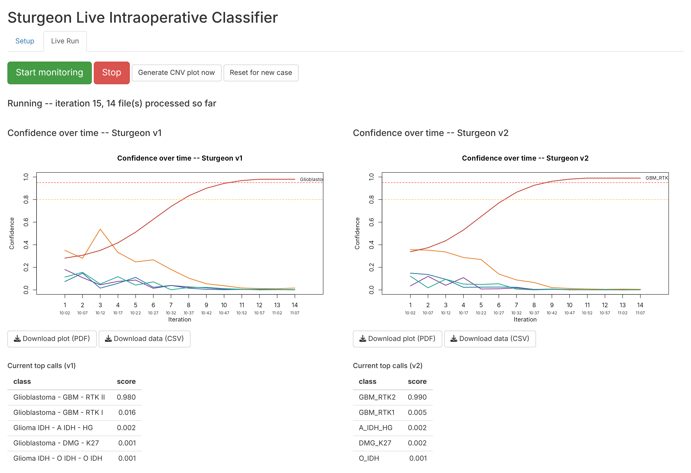

# Shiny-Sturgeon

**A local Shiny GUI for live intraoperative Sturgeon methylation classification of Oxford Nanopore sequencing runs.**

[](https://github.com/tgac-vumc/Shiny_Sturgeon/actions/workflows/tests.yml) [](https://doi.org/10.5281/zenodo.24534277)   

Shiny-Sturgeon watches a MinKNOW run folder as it fills up during sequencing, and automatically runs the methylation-extraction and tumor-classification pipeline on every new batch of reads, showing a live confidence-over-time plot and a periodically-updated copy-number (CNV) plot.

> **Research use only.** This tool orchestrates existing classification software (Sturgeon / sturgeon-v2) and visualizes its output — it does not itself perform or validate any diagnostic classification. It has not been independently validated as a clinical decision-support device. Always cross-check results against your institution's standard pipeline before using them to inform patient care.
>
> The [Sturgeon V2 preprint](https://doi.org/10.64898/2026.10.19.26365910) describes the *classifier* as clinically applicable. That does not extend to this app: the live pipeline around the classifier (file handling, cumulative re-aggregation, plotting) has not been validated as a whole.



*The Live Run tab, showing a [synthetic demo case](#testing-and-synthetic-data) (made-up scores, no CNV plot).*

---

## Table of contents

- [What it does](#what-it-does)
- [Requirements](#requirements)
- [Installation](#installation)
- [Configuration](#configuration)
- [Usage](#usage)
- [How it works](#how-it-works)
- [Output folder layout](#output-folder-layout)
- [Resuming an interrupted run](#resuming-an-interrupted-run)
- [Running two classifier models (v1 + v2)](#running-two-classifier-models-v1--v2)
- [Known limitations](#known-limitations)
- [Testing and synthetic data](#testing-and-synthetic-data)
- [Acknowledgments](#acknowledgments)
- [Citation](#citation)
- [License](#license)

## What it does

During intraoperative sequencing, MinKNOW basecalls, calls methylation, and aligns reads in real time, writing BAM files to disk as they're produced. Shiny-Sturgeon polls that folder, and for every new batch of reads it:

1. merges and sorts the new BAMs,
2. runs `modkit` to extract methylation calls,
3. aggregates *all* methylation data collected so far for the case (not just the latest batch),
4. classifies that cumulative data with [Sturgeon](https://github.com/UMCUGenetics/sturgeon),
5. updates a confidence-over-time plot and a top-calls table, and
6. every few iterations, rebuilds a CNV plot from all reads processed so far.

## Requirements

**External tools** (installed separately; conda environment files are in [`envs/`](envs/), see [Installation](#installation)):

- `samtools`
- [`modkit`](https://github.com/nanoporetech/modkit)
- [`sturgeon`](https://github.com/UMCUGenetics/sturgeon) (v1)
- [`sturgeon-v2`](https://github.com/deRidderLab/sturgeon-v2) (v2, optional)

**R** with shiny, yaml, QDNAseq and DNAcopy. The exact versions are recorded in `renv.lock` (see [Installation](#installation)).

**Reference/model files** (not included in this repo; they are distributed with Sturgeon under its own license):

- from the [Sturgeon v1 repository](https://github.com/UMCUGenetics/sturgeon)'s `R_scripts/` folder:
  - `probelocs_chm13.bed` — probe positions
  - `chm13_v2.0_bins.rds` — QDNAseq bins for the CNV plot
  - `bins_export.bed` — CNV reference coverage
  - `color_translation.rds` — tumor class to plot color
  - `relevant_genes_with_chm13v2_1Mb_bin_nrs.bed` — gene labels on the CNV plot (optional)
- a Sturgeon v1 model (`general.zip`; see the Sturgeon README)
- optionally, a sturgeon-v2 model (e.g. `cns-v2.5.zip`, [Zenodo](https://zenodo.org/records/22899108))

**Data source:** a MinKNOW run configured to basecall, call methylation, and align in real time, writing to a `bam_pass/` folder containing `barcode<NN>/` and `unclassified/` subfolders.

## Installation

**New to the command line?** Follow the [step-by-step installation guide](docs/install-guide.md), with screenshots.

### Quick install

On Ubuntu/Debian with R 4.6 installed:

```bash
git clone https://github.com/tgac-vumc/Shiny_Sturgeon.git
```

```bash
cd Shiny_Sturgeon && ./install.sh
```

`install.sh` asks before each step, and can be run again safely. It:

1. installs the system libraries R needs to build its packages (apt, needs sudo);
2. creates the two conda environments in [`envs/`](envs/) (`sturgeon`: samtools, modkit and Sturgeon v1; `sturgeon-v2`), installing Miniforge first if there is no conda;
3. runs `renv::restore()`;
4. downloads the Sturgeon v1 model, the sturgeon-v2 model and the Sturgeon v1 `R_scripts/` reference files into `resources/`, after you accept the Sturgeon license (these files are not bundled with this app; see [Requirements](#requirements));
5. writes `config_local.yml` (not in git) with the full paths of all tools and files.

The app then opens with those paths filled in, so the Setup tab only needs the MinKNOW folder, the barcode and the output folder. Start it with `./run_app.sh`. See `./install.sh --help` for options such as `--yes --accept-sturgeon-license` (unattended), `--no-v2` and `--data-dir`.

### Manual install

The steps below are what `install.sh` does.

```bash
git clone https://github.com/tgac-vumc/Shiny_Sturgeon.git
cd Shiny_Sturgeon
```

**R packages.** Some Bioconductor packages (Rsamtools, used by QDNAseq) are built from source and need these system libraries first. On Ubuntu/Debian:

```bash
sudo apt-get install -y libcurl4-openssl-dev libssl-dev libxml2-dev libbz2-dev liblzma-dev zlib1g-dev libdeflate-dev
```

The repository uses [renv](https://rstudio.github.io/renv/): starting R in the repository folder activates it, and this installs the recorded package versions (R 4.6, Bioconductor 3.23):

```r
renv::restore()
```

**External tools.** The conda environment files in [`envs/`](envs/) pin the [tested versions](#tested-with). Sturgeon v1 needs Python older than 3.10 and sturgeon-v2 needs Python 3.10 or later, so they are two environments:

```bash
conda env create -f envs/sturgeon.yml
```

```bash
conda env create -f envs/sturgeon-v2.yml
```

Download the reference and model files listed under [Requirements](#requirements). Then confirm the external tools are reachable:

```bash
which samtools modkit sturgeon sturgeon-v2
```

If any of them live inside a conda/venv environment that isn't active when you launch R, don't rely on shell activation — the app calls tools directly, it doesn't source `conda.sh`. Instead, either point the Setup tab's binary-path fields straight at the environment's executables (e.g. `~/miniconda3/envs/sturgeon2/bin/sturgeon`), or add that environment's `bin/` directory under **"Extra PATH directories"** in Setup.

After updating R packages on a machine where the app works, record the new versions with `renv::snapshot()` and commit `renv.lock`.

### Tested with

Version 1.0.0 was validated by replaying a previous case on Linux and comparing the Sturgeon v1 and v2 calls and the CNV profile with that case's earlier result:

| Software | Version |
|---|---|
| R | 4.6.2 (packages in `renv.lock`, Bioconductor 3.23) |
| samtools | 1.22.1 |
| modkit | 0.5.0 |
| Sturgeon v1 | 0.5.1 (commit `80c33fb`) |
| sturgeon-v2 | commit `d581abf` |

## Configuration

All settings live in a YAML config, editable either by hand or from the app's **Setup tab**, which saves a per-case copy to `<output_folder>/config.yml`. When the app starts, it reads `config_default.yml` (the template), then `config_local.yml` if `install.sh` wrote one (this machine's tool and reference paths); loading a case's `config.yml` overrides both.

| Field | Purpose |
|---|---|
| `bam_pass_folder` | MinKNOW's live BAM output folder (contains `barcode01/`, `barcode02/`, …, `unclassified/`) |
| `barcode` | which barcode to monitor |
| `use_unclassified` | also include reads MinKNOW couldn't assign a barcode to |
| `output_folder` | a fresh folder per case where this app writes all its own output |
| `poll_interval_sec` | how often to check for new BAM files |
| `cnv_every_n_iterations` | how often to auto-rebuild the CNV plot |
| `samtools_bin` / `modkit_bin` / `sturgeon_bin` | paths to each tool (or bare names if on `PATH`) |
| `extra_path_dirs` | directories to prepend to `PATH` (e.g. a conda env's `bin/`) |
| `probes_file`, `model_file_v1`, `bins_rds`, `cnvplot_reffile`, `color_translation_rds` | reference/model files (see [Requirements](#requirements)) |
| `class_mapping_v2` | optional CSV that gives v2 classes the color of their v1 counterpart — see [below](#running-two-classifier-models-v1--v2) |
| `model_file_v2`, `sturgeon_v2_bin`, `sturgeon_v2_mode`, `sturgeon_v2_num_cpgs`, `sturgeon_v2_num_samplings`, `sturgeon_v2_file_type` | optional sturgeon-v2 configuration — see [below](#running-two-classifier-models-v1--v2) |

`output_folder` and `bam_pass_folder` must be full absolute paths (not `~` or a relative path) — the app validates this before letting you start.

## Usage

```bash
./run_app.sh
```

or run `shiny::runApp("Shiny_Sturgeon")` in R, or open `app.R` in RStudio and click **Run App**.

1. **Setup tab** — fill in the MinKNOW folder, barcode, an empty output folder for this case, and (unless `install.sh` filled them in) the tool and reference file paths. Click **Check installation** to confirm every tool, file and folder is found, then **Save configuration**.
2. **Live Run tab** — click **Start monitoring**. The app checks for new BAMs on the configured interval, processes each new batch through the full pipeline, and updates the confidence-over-time plot and top-calls table live. **Generate CNV plot now** triggers an off-schedule CNV rebuild at any point.
3. **Stop** pauses monitoring without losing any progress. **Reset for new case** clears the in-app state so you can point Setup at a fresh output folder for the next case, without restarting the app.

## How it works

```
MinKNOW bam_pass/barcode<NN>/*.bam
        │  (poll every N seconds)
        ▼
merge + sort new BAMs  ──►  modkit adjust-mods  ──►  modkit extract full
                                                            │
                                            (accumulates across the whole case)
                                                            ▼
                                    sturgeon inputtobed  (re-aggregates everything so far)
                                                            │
                                          ┌─────────────────┴─────────────────┐
                                          ▼                                   ▼
                                  sturgeon predict (v1)              sturgeon-v2 predict 
                                          │                                   │
                                          ▼                                   ▼
                              confidence-over-time plot (v1)      confidence-over-time plot (v2)

  every N iterations: merge every modkit-adjusted BAM so far → CNV plot
```

## Output folder layout

Everything is written to plain files under `output_folder` as the case runs:

```
output_folder/
├── config.yml                     # this case's saved settings
├── processed_files.txt            # BAM files already handled (for resuming)
├── modkit_extract/                # one .txt per iteration, accumulates all case
├── bed_v1/ , bed_v2/               # current cumulative aggregated bed per model
├── classifier_progress_v1.txt     # full confidence-over-time history, v1
├── classifier_progress_v2.txt     # full confidence-over-time history, v2
├── CNV_data/                      # merged BAMs + CNV snapshots
└── iteration<N>/                  # this iteration's merged/sorted/adjusted BAM
```

## Resuming an interrupted run

If the app or its R session is stopped mid-case — intentionally or not — starting it again with the **same `output_folder`** picks up exactly where it left off: already-processed reads aren't reprocessed, the confidence-over-time plots and CNV state are restored from the files above, and iteration numbering continues rather than resetting to 1.

## Running two classifier models (v1 + v2)

Once `model_file_v2` is set, both models run automatically every iteration and get their own confidence-over-time plot and top-calls table — no need to choose one. The expensive step (`sturgeon inputtobed`) is shared between them when they use the same probes file, so adding v2 only adds one extra `predict` call, not a second full pipeline.

`NUM_CPGS` and `NUM_SAMPLINGS` are left blank by default, in which case sturgeon-v2 uses its own defaults (all available CpG sites, 1 random sampling) — fill them in only if you want to override those.

v1 and v2 use different tumor-class names (e.g. `GBM_RTK2` vs. `Glioblastoma - GBM - RTK II`), and `color_translation.rds` is keyed to v1's names. To draw v2 classes in their v1 color, set `class_mapping_v2` to a CSV with columns `v2_class,v1_class`. The bundled [`class_mapping_v2.csv`](class_mapping_v2.csv) covers five classes so far; extend it as needed. v2 classes without a mapping get a fixed fallback color per class. The mapping only changes colors — class names in plots and tables stay as the classifier reports them.

The public sturgeon-v2 release treats `-o` as an output folder and writes a tab-separated `result.txt` into it, with one row per random sampling; earlier versions wrote one comma-separated file at the `-o` path. The app reads either, and averages over samplings (as sturgeon-v2's own summary does). `sturgeon_v2_file_type` is `bed`, because the app feeds sturgeon-v2 the bed file made by `sturgeon inputtobed`.

## Known limitations

- **One R process, one active pipeline.** R is single-threaded: don't run two long-lived instances of this app (or this app alongside the old polling script) in the same R session/console — they'll compete for the same thread and can starve each other. Run separate pipelines in separate R processes if you need to compare them side by side.
- **Partial v1↔v2 color mapping.** The bundled mapping covers five classes; other v2 classes get fallback colors (see above).
- **Confidence-plot labels can be cut off.** The class label next to a line above 0.5 is drawn at the right edge of the plot and long v1 names are clipped.

## Testing and synthetic data

The repository contains no patient or sequencing data. Everything used for testing is synthetic.

**Unit tests** check BAM discovery, result parsing for Sturgeon v1 and both sturgeon-v2 output formats, the progress table and resume round trip, colors, config validation, and the exact commands sent to samtools, modkit, sturgeon and sturgeon-v2 (using small stand-in scripts instead of the real tools). They need only the R packages, no external tools or model files:

```bash
Rscript tests/run_tests.R
```

They run on every push in GitHub Actions, together with a check that synthetic BAMs pass through samtools and modkit 0.5.0 the way the app runs them.

**Synthetic BAMs.** [`tools/make_synthetic_bams.py`](tools/make_synthetic_bams.py) (needs `pip install pysam`) writes a MinKNOW-style `bam_pass/` folder: aligned reads on T2T-CHM13v2.0 contigs with 5mC/5hmC calls in MM/ML tags, optionally at the Sturgeon probe positions and with a fake copy-number gain or loss. With `--live-interval` it writes one file at a time, so you can watch the app pick them up:

```bash
python tools/make_synthetic_bams.py --out /tmp/synthetic/bam_pass \
    --probes /path/to/probelocs_chm13.bed --gain 7 --loss 10 --live-interval 30
```

The methylation calls are random, so a classification of this data is meaningless; use it to test the pipeline, never the classifier.

**Demo case.** [`tools/make_demo_case.R`](tools/make_demo_case.R) builds a case folder with made-up confidence curves for both models (the screenshot above). Open it by entering `<folder>/case` as the output folder on the Setup tab, clicking **Load config.yml from output folder**, and then **Start monitoring**:

```bash
Rscript tools/make_demo_case.R /tmp/shiny_sturgeon_demo
```

## Acknowledgments

This app is a GUI/orchestration layer around existing tools — it does not implement any classification or basecalling itself:

- [Sturgeon](https://github.com/UMCUGenetics/sturgeon) and [sturgeon-v2](https://github.com/deRidderLab/sturgeon-v2) for methylation-based tumor classification (see [Citation](#citation))
- [`modkit`](https://github.com/nanoporetech/modkit) for methylation call extraction
- [QDNAseq](https://bioconductor.org/packages/QDNAseq/) / [DNAcopy](https://bioconductor.org/packages/DNAcopy/) for CNV binning and segmentation

## Citation

This app runs the Sturgeon classifiers; please cite the paper for each one you use.

Sturgeon (v1):

> Vermeulen C, Pagès-Gallego M, Kester L, *et al.* Ultra-fast deep-learned CNS tumour classification during surgery. *Nature* (2023). doi: [10.1038/s41586-023-06615-2](https://doi.org/10.1038/s41586-023-06615-2)

Sturgeon v2:

> Vermeulen C, van der Ent H, Maas SL, *et al.* Sturgeon V2: a clinically applicable CNS tumor classifier trained on relabeled data. *medRxiv* (2026). doi: [10.64898/2026.10.19.26365910](https://doi.org/10.64898/2026.10.19.26365910)

To cite Shiny-Sturgeon itself, use its Zenodo DOI, [10.5281/zenodo.24534277](https://doi.org/10.5281/zenodo.24534277), or the **"Cite this repository"** button on GitHub (generated from [`CITATION.cff`](CITATION.cff)).

## License

MIT license
