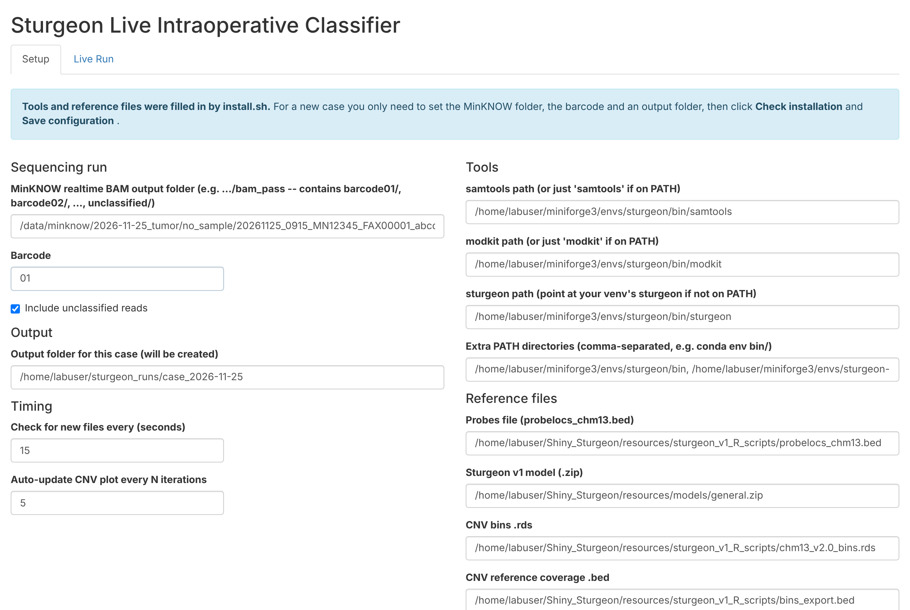
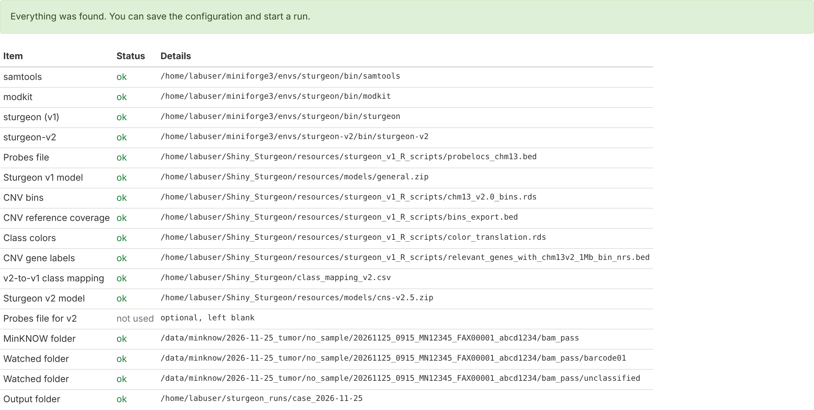
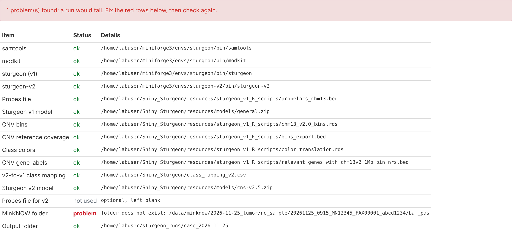
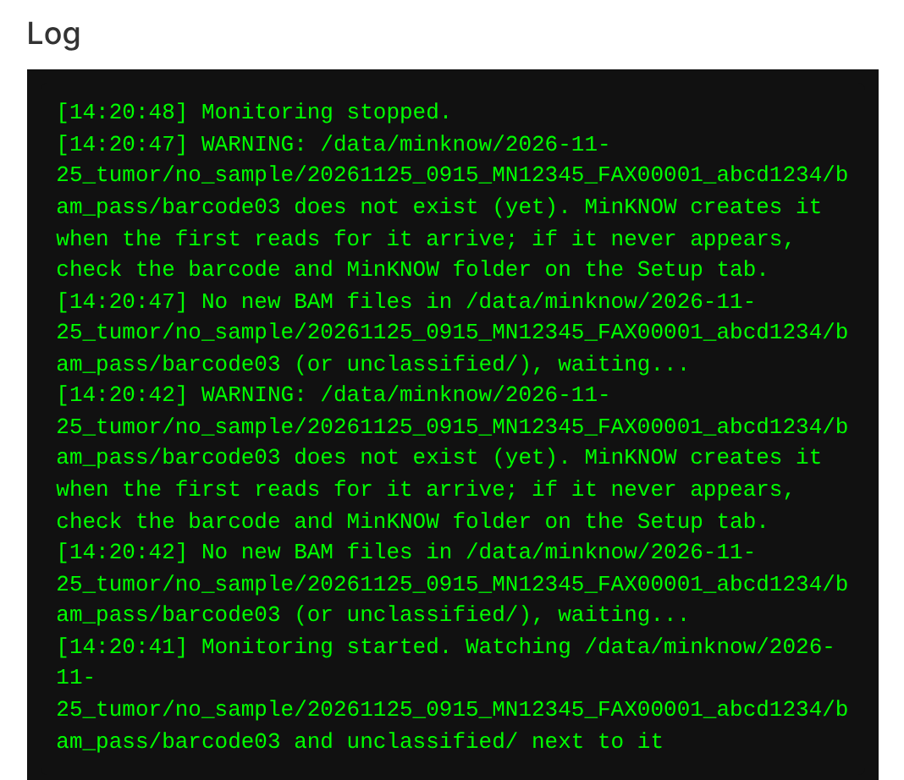

# Installing and running Shiny-Sturgeon: a step-by-step guide

This guide is for people who are comfortable using a computer but don't usually work on the command line. It walks you through installing Shiny-Sturgeon on the Linux computer that runs (or can see the output of) the MinKNOW sequencing software, and then running your first case.

You'll type a handful of commands into a **terminal**. Each command is in a grey box; copy it, paste it into the terminal (in most Linux terminals: <kbd>Ctrl</kbd>+<kbd>Shift</kbd>+<kbd>V</kbd>), and press <kbd>Enter</kbd>.

> **Research use only.** Shiny-Sturgeon shows the output of the Sturgeon classifiers live during a run. It has not been validated as a clinical decision-support device; always cross-check its results against your institution's standard pipeline.

---

## Contents

1. [What you need](#1-what-you-need)
2. [Install R](#2-install-r)
3. [Download Shiny-Sturgeon](#3-download-shiny-sturgeon)
4. [Run the installer](#4-run-the-installer)
5. [Start the app](#5-start-the-app)
6. [Set up a case](#6-set-up-a-case)
7. [Check the installation](#7-check-the-installation)
8. [Run the case](#8-run-the-case)
9. [Troubleshooting](#9-troubleshooting)

---

## 1. What you need

- A **Linux** computer (Ubuntu 22.04 or 24.04 is what this guide assumes). The tools Shiny-Sturgeon runs (modkit, Sturgeon) work only on Linux.
- An **internet connection** during installation (several GB of downloads).
- About **10 GB of free disk space** for the programs, plus space for each case's output.
- An account that may use `sudo` (install software), or someone who can run step 2 and the first part of step 4 for you.
- **MinKNOW** set up to basecall, call methylation (5mC/5hmC) and align to the **T2T-CHM13v2.0** reference genome during the run, writing BAM files. Your sequencing facility usually sets this up.

To open a terminal: press <kbd>Ctrl</kbd>+<kbd>Alt</kbd>+<kbd>T</kbd>, or search for "Terminal" in the applications menu.

## 2. Install R

Shiny-Sturgeon is written in R. Check whether R is already installed:

```bash
R --version
```

If this prints `R version 4.6...` (or newer), skip to step 3. Otherwise, install R from CRAN, the official R distribution. These commands add CRAN's package source to Ubuntu and install R; they will ask for your password:

```bash
sudo apt-get update && sudo apt-get install -y --no-install-recommends software-properties-common dirmngr wget git
```

```bash
wget -qO- https://cloud.r-project.org/bin/linux/ubuntu/marutter_pubkey.asc | sudo tee /etc/apt/trusted.gpg.d/cran_ubuntu_key.asc
```

```bash
sudo add-apt-repository -y "deb https://cloud.r-project.org/bin/linux/ubuntu $(lsb_release -cs)-cran40/"
```

```bash
sudo apt-get install -y r-base r-base-dev
```

Run `R --version` again to confirm. (If these steps change, the current instructions are at <https://cran.r-project.org/bin/linux/ubuntu/>.)

## 3. Download Shiny-Sturgeon

This puts Shiny-Sturgeon in a folder called `Shiny_Sturgeon` in your home folder:

```bash
cd ~ && git clone https://github.com/tgac-vumc/Shiny_Sturgeon.git
```

## 4. Run the installer

```bash
cd ~/Shiny_Sturgeon && ./install.sh
```

The installer works through five steps and asks before each big one. Press <kbd>Enter</kbd> to answer "yes".

| Step | What happens | How long |
|---|---|---|
| 1. System libraries | Installs a few libraries R needs to build its packages. Asks for your password. | 1 minute |
| 2. Conda environments | Installs samtools, modkit, Sturgeon v1 and sturgeon-v2 into two separate *conda environments* (self-contained software folders), because Sturgeon v1 and v2 need different Python versions. If conda isn't installed, it offers to install Miniforge (a small conda) in `~/miniforge3`. | 5–15 minutes |
| 3. R packages | Installs the exact R package versions Shiny-Sturgeon was tested with. The first time, this compiles several packages. | 20–40 minutes |
| 4. Models and reference files | Downloads the Sturgeon classifier models and the Sturgeon v1 reference files into `~/Shiny_Sturgeon/resources/`. | a few minutes |
| 5. Configuration | Writes `config_local.yml`, so the app opens with every tool and file already filled in. | instant |

**The Sturgeon license.** Before step 4 the installer shows a link to Sturgeon's license and asks whether you accept it. The models and reference files are made by the Sturgeon authors and are not part of Shiny-Sturgeon, so they are downloaded from their original sources under that license. A copy of the license is saved as `resources/STURGEON_LICENSE.txt`.

At the end you'll see either **Installation complete.** or a list of warnings. Each warning says what went wrong and what to do; see also [Troubleshooting](#9-troubleshooting). You can run `./install.sh` again at any time: it skips what is already done.

<details>
<summary>Installer options (for IT staff)</summary>

```
./install.sh --help
  --data-dir DIR             where models and reference files go (default: ./resources)
  --yes, -y                  don't ask before each step
  --accept-sturgeon-license  accept the Sturgeon license without being asked (needed with --yes)
  --no-v2                    skip sturgeon-v2 (its environment and model)
  --skip-system              don't install system libraries (no sudo needed)
  --skip-conda               don't create or update the conda environments
  --skip-r                   don't install R packages
  --skip-downloads           don't download models and reference files
```

</details>

## 5. Start the app

```bash
~/Shiny_Sturgeon/run_app.sh
```

This starts the app and opens it in your web browser. If no browser opens, go to <http://127.0.0.1:8080> yourself. Keep the terminal window open while you use the app; closing it (or pressing <kbd>Ctrl</kbd>+<kbd>C</kbd> in it) stops the app.

The app runs only on this computer; nothing is sent over the internet.

## 6. Set up a case

The app opens on the **Setup** tab. Because the installer filled in all the tools and reference files (right-hand column), you only need to fill in three things for each new case:



1. **MinKNOW realtime BAM output folder.** The `bam_pass` folder of this sequencing run. MinKNOW usually writes runs under `/data/` or `/var/lib/minknow/data/`, in a folder named after the experiment, then the sample, then the run, e.g.
   `/data/minknow/2026-11-25_tumor/no_sample/20261125_0915_MN12345_FAX00001_abcd1234/bam_pass`
   It contains folders named `barcode01`, `barcode02`, … and `unclassified`. (In MinKNOW, the run's output folder is shown on the run's summary page.)
2. **Barcode.** The barcode the sample was loaded with, e.g. `01`.
3. **Output folder for this case.** A new, empty folder where Shiny-Sturgeon writes everything for this case, e.g. `/home/labuser/sturgeon_runs/case_2026-11-25`. Use a full path starting with `/`. It is created if it doesn't exist.

Leave **Include unclassified reads** ticked unless you know you don't want reads without a barcode.

## 7. Check the installation

Click **Check installation** at the bottom of the Setup tab. The app checks that every program and file it needs can be found:



- **ok** (green): found.
- **problem** (red): a run would fail. The *Details* column says what's wrong. Fix it and click **Check installation** again.
- **warning** (orange): worth a look, but you can start. A common one is *"barcode01 does not exist yet"* before MinKNOW has written its first reads; that's normal at the very start of a run.
- **not used** (grey): an optional item that is left blank.

Here, for example, the MinKNOW folder was mistyped (`bam_pas` instead of `bam_pass`):



When everything is green, click **Save configuration**. This saves this case's settings to `config.yml` in the output folder.

## 8. Run the case

Go to the **Live Run** tab and click **Start monitoring**. From now on the app checks the MinKNOW folder every 15 seconds. For every batch of new reads it extracts the methylation data, runs the classifiers on everything collected so far, and updates:

- the **confidence-over-time** plots (one for Sturgeon v1, one for v2) and the current top calls below them;
- the **CNV plot**, every 5 batches, or right away with **Generate CNV plot now**.

The **Log** box (bottom right) shows what the app is doing, newest line at the top. It names the exact folder it is watching and warns if that folder doesn't exist:



If you keep seeing *"WARNING: …/barcode03 does not exist (yet)"* after MinKNOW has been writing reads for a while, the barcode or MinKNOW folder on the Setup tab is probably wrong. Click **Stop**, correct it on the Setup tab, and click **Start monitoring** again.

- **Stop** pauses monitoring. Nothing is lost; **Start monitoring** continues where it stopped.
- If the app or the computer was closed mid-case, start the app, enter the **same output folder**, click **Load config.yml from output folder** and then **Start monitoring**. It picks up where it left off.
- **Reset for new case** clears the screen for the next case. Then enter a new output folder on the Setup tab.
- The download buttons save the plots as PDF and the scores as CSV. All results are also kept in the case's output folder.

## 9. Troubleshooting

**"Permission denied" when running `./install.sh`.** Run `bash install.sh` instead.

**The installer says "R is not installed".** Do [step 2](#2-install-r), then run `./install.sh --skip-conda --skip-downloads` to finish the R part.

**"renv::restore() failed".** Usually a missing system library. Scroll up to the first `ERROR` message; it often names a missing file such as `curl/curl.h` or `libxml/parser.h`. Ask your IT department to install the matching `-dev` package, then run `./install.sh --skip-conda --skip-downloads` again.

**A model download failed.** The Sturgeon v1 model comes from Dropbox and the v2 model from Zenodo; some hospital networks block these sites. Download them on another computer:
- Sturgeon v1: `general.zip`, linked from the [Sturgeon README](https://github.com/UMCUGenetics/sturgeon#available-models)
- Sturgeon v2: the model zip from <https://zenodo.org/records/22899108>

Copy them into `~/Shiny_Sturgeon/resources/models/`, then run:

```bash
cd ~/Shiny_Sturgeon && ./install.sh --skip-system --skip-conda --skip-r
```

**Check installation says a program is "not found".** Rerun the installer (`./install.sh --skip-system --skip-r --skip-downloads`) to repair the conda environments and update the paths.

**The browser says "This site can't be reached".** The app isn't running: start it again with `~/Shiny_Sturgeon/run_app.sh` and keep that terminal open. If port 8080 is in use, choose another: `~/Shiny_Sturgeon/run_app.sh 8090`.

**An iteration shows `ERROR` in the log.** The line below it shows the failing command and its output. The app carries on with the next batch of reads. If every iteration fails, send the log text (select it and copy) and the case's `config.yml` to whoever maintains your installation.
